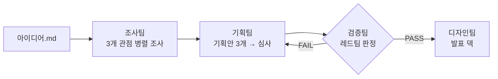

# agent-teams

Claude Code에서 여러 에이전트를 팀처럼 굴리려고 만든 플러그인 모음입니다. 조사·기획·검증·디자인·수업 5개 팀과, 이 팀들을 실행하고 기록하는 하네스(`hq-core`)로 이루어져 있습니다. 에이전트 15개, 파이프라인 그래프 8개, 커맨드 11개가 들어 있습니다.

## 설계 원칙

- **만든 에이전트와 검사하는 에이전트를 나눈다.** 에이전트가 자기 산출물을 자기가 통과시키지 않도록, 모든 파이프라인에 반박·심사·사실확인을 맡는 노드가 따로 있습니다.
- **상태는 파일과 실행 기록에 둔다.** 노드는 파일을 받아 파일을 내고, 실행할 때마다 기록(레저)이 남습니다. 세션이 끊겨도 기록에서 이어서 실행합니다.

## 구성

| 플러그인 | 파이프라인 |
|---|---|
| `hq-core` | 그래프 실행기, 실행 기록, 추적 훅, 쓰기 가드, 실시간 대시보드, 외부 작업자(Cursor·OpenCode) 어댑터 |
| `research-team` | 3개 관점 병렬 조사 → 종합 → 사실확인 → 브리프 |
| `planning-team` | 3개 관점 기획안 병렬 작성 → 심사 → 스펙 → 실행 계획 |
| `verify-team` | 선행 사례 조사 → 레드팀 반박 → 판정 |
| `design-team` | 2개 방향 시안 병렬 제작 → 비평 → 디자인 스펙 / 스토리라인 → 슬라이드 → 검토 → 발표 덱 |
| `class-team` | 개념 노트와 문제 10개 병렬 작성 → 원문 대조 검사 → 수업 노트 / 과제 분해 → 초안 → 채점자 관점 검토 |

## 실제로 쓴 곳

| 날짜 | 어디에 | 파이프라인 | 결과 |
|---|---|---|---|
| 2026-09-14 | 동작구 정책아이디어리그: 구 단위 경제정책 사례 조사 | research | 주장 17개를 원출처에서 다시 확인. 1회차에서 반려돼 다시 종합했고, 2회차에서도 틀린 주장 1건이 남아 사람 검토로 넘김 |
| 2026-09-27 | 금융학회 PAPERS: 한국 주식시장 이상현상 연구 주제 조사 | research | 주장 17개를 원출처에서 다시 확인. 2회차에서 일부만 맞는 주장 3건이 남아 사람 검토로 넘김 |
| 2026-10-24 | 자연어처리 팀 프로젝트: 구현 설계 검증 | verify | 레드팀 반박 뒤 조건부 통과 (치명 결함 0건) |

## 팀을 이어 붙인 예: 공모전 미션

`hq-core/graphs/contest.json`은 아이디어 문서 하나를 네 팀이 차례로 넘겨받는 그래프입니다. 검증에서 떨어지면 기획으로 되돌아가고, 두 번 떨어지면 사람에게 넘깁니다.



## 그래프 규약

파이프라인은 `graph.json`으로 선언합니다. 노드는 에이전트이고, 노드 사이는 파일로 이어집니다.

```json
{
  "id": "judge",
  "agent": "planning-team:judge",
  "inputs": ["{target}", "{brainstorm_a.out}", "{brainstorm_b.out}", "{brainstorm_c.out}"],
  "outputs": ["_work/plan/{stem}.judge.md"],
  "prompt": "목표: … 제약: … 완료조건: …"
}
```

- 실행 순서는 입력이 참조하는 노드 출력으로 정해지고, 서로 독립인 노드는 병렬로 실행합니다.
- 노드가 끝나면 출력 파일이 있는지와 머리말(type, status, owner)을 검사합니다.
- 서브에이전트는 `deliverables/`와 `runs/`에 쓸 수 없습니다. 쓰기 가드 훅이 막습니다.
- 에이전트가 낸 판정을 오케스트레이터가 요약하거나 고쳐 쓰지 않습니다. 파일에 적힌 것이 전부입니다.

전체 규약은 [`hq-core/skills/graph/SKILL.md`](hq-core/skills/graph/SKILL.md)에 있습니다.

## 폴더

```
.claude-plugin/marketplace.json   플러그인 6개를 묶은 마켓플레이스 정의
hq-core/
  scripts/    hq.py(실행기), hqlib.py, guard.py, trace.py, dashboard.py, worker.py
  graphs/     contest.json
  hooks/      세션·서브에이전트·파일 쓰기 시점에 추적과 가드를 거는 훅
<team>/
  agents/     에이전트 정의
  commands/   슬래시 커맨드
  graphs/     파이프라인 그래프
  skills/     산출물 양식
```

## 사용

개인 작업 환경에 맞춰 만든 도구입니다. 이 저장소를 `<AI_HQ_ROOT>/teams`로 받고 환경변수 `AI_HQ_ROOT`를 그 상위 폴더로 지정한 뒤, Claude Code에서 마켓플레이스로 등록합니다.

```
/plugin marketplace add <AI_HQ_ROOT>/teams
```

등록하면 `/research-team:research`, `/planning-team:plan`, `/verify-team:verify`, `/hq-core:contest` 같은 커맨드가 생깁니다. 실행 기록은 프로젝트의 `runs/<run_id>/`에 남고, `/hq-core:dashboard`로 진행 상황을 볼 수 있습니다.
